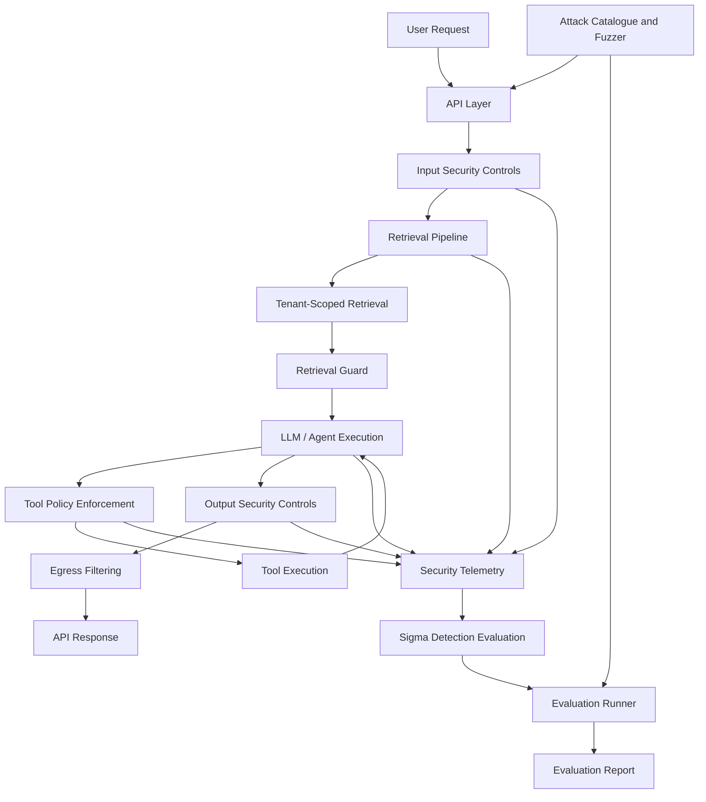

 <h1 align="center">AegisRAG</h1>

<p align="center"><b>A Security Evaluation Lab for Multi-Tenant RAG Systems and Tool-Using AI Agents</b></p>

<p align="center">
  
  
  
  
  
  
  
</p>

---

## Contents

- [Overview](#overview)
- [Objectives](#objectives)
- [What's New in v0.2](#whats-new-in-v02)
- [Features](#features)
- [Architecture](#architecture)
- [Security Control Architecture](#security-control-architecture)
- [Attack Evaluation](#attack-evaluation)
- [Detection Engineering](#detection-engineering)
- [Repository Structure](#repository-structure)
- [Quick Start](#quick-start)
- [Testing and Validation](#testing-and-validation)
- [Using a Real LLM](#using-a-real-llm)
- [Infrastructure and Cloud Security](#infrastructure-and-cloud-security)
- [Scope and Limitations](#scope-and-limitations)
- [Roadmap](#roadmap)
- [References](#references)
- [Disclaimer](#disclaimer)
- [Author](#author)

---

## Overview

AegisRAG is a security evaluation lab designed to investigate vulnerabilities in multi-tenant Retrieval-Augmented Generation (RAG) systems and tool-using AI agents.

It provides a controlled environment where AI security mechanisms can be independently configured, attacked, tested, and measured.

The project explores a fundamental security question:

> When a model can be talked into anything, which security controls still hold?

Rather than treating prompt injection as an isolated problem, AegisRAG examines the security of the entire application surrounding an LLM, including document retrieval, tenant isolation, caching, tool execution, data handling, and outbound communication.

The project is deliberately structured as an experimental security lab, not a production product.

It focuses on two interconnected areas:

- **Offensive AI security evaluation:** Testing prompt injection, cross-tenant data leakage, unauthorized tool execution, information disclosure, and guard evasion.
- **Defensive AI security engineering:** Implementing deterministic enforcement, probabilistic detection, output filtering, security telemetry, and measurable defensive controls.

The objective is to understand what happens when an AI model behaves unexpectedly and determine which application-level security boundaries remain effective.

## Objectives

- Evaluate security weaknesses in multi-tenant RAG architectures.
- Investigate direct and indirect prompt injection.
- Test cross-tenant information disclosure and retrieval isolation.
- Evaluate tool-using agent security and authorization boundaries.
- Implement independently configurable security controls.
- Examine the limitations of keyword-based prompt injection detection.
- Develop guard-evasion fuzzing techniques.
- Build an attack catalogue with measurable outcomes.
- Develop Sigma detections for suspicious AI application activity.
- Map relevant attack behaviours to MITRE ATLAS.
- Evaluate defensive effectiveness through controlled experiments.
- Establish an AWS infrastructure foundation for future deployment.

## What's New in v0.2

Version 0.2 replaces the original MVP with an expanded security evaluation framework.

The update addresses issues identified during the v0.1 review. Each identified bug and corresponding fix is documented in [`docs/CHANGES.md`](docs/CHANGES.md) and mapped to regression tests.

Major additions include:

| Component | Addition |
|---|---|
| Agent execution | Real agent loop with tool-using behaviour |
| Retrieval | Hybrid retrieval pipeline |
| Attack catalogue | 17 attacks with statistical evaluation |
| Guard evasion | Fuzzer for generating attack variations |
| Security controls | Eight independently configurable controls |
| Detection engineering | 13 single-event Sigma rules and 3 correlation rules |
| Threat mapping | MITRE ATLAS mapping |
| Evaluation | Confidence intervals and leave-one-out ablation |
| Infrastructure | Terraform-based AWS security foundation |
| Regression testing | 110+ tests and mutation testing |

### Development Status

| Component | Status |
|---|---|
| Application and agent execution | Implemented |
| Security controls | Implemented and tested locally |
| Attack catalogue and runner | Implemented |
| Guard-evasion fuzzer | Implemented |
| Sigma detection rules | Implemented |
| MITRE ATLAS mapping | Implemented |
| Automated test suite | 110+ tests |
| Mutation testing | 7/7 deliberate sabotage mutations detected |
| Evaluation report | Reproducible simulated-model results |
| Ollama integration | Implemented, live validation pending |
| AWS Bedrock integration | Implemented, live validation pending |
| Terraform foundation | Static validation completed |
| Cloud deployment | Not implemented |
| Real-LLM evaluation | Pending |

**Important:** The Terraform configuration has not been applied to an AWS account. The current infrastructure is a foundation, not a completed cloud deployment.

## Features

### 1. Multi-Tenant RAG Security

Evaluates the security boundaries between different tenants in a shared RAG environment.

Key areas include:

- Tenant-scoped document retrieval.
- SQL-level tenant isolation.
- Cross-tenant information disclosure testing.
- Tenant-aware answer caching.
- Fail-closed behaviour when tenant identity is unavailable.

### 2. Prompt Injection Evaluation

Tests how malicious instructions can influence model behaviour through direct user input and retrieved content.

Evaluation areas include:

- Direct prompt injection.
- Indirect prompt injection.
- Multilingual injection attempts.
- Paraphrased malicious instructions.
- Retrieved-document poisoning.
- System prompt extraction.
- Guard-evasion variations.

### 3. Tool-Using Agent Security

Evaluates security risks introduced when an LLM can invoke application tools.

The implementation includes:

- Tool allowlisting.
- Strict argument schemas.
- Rejection of model-supplied tenant identifiers.
- Human approval for state-changing operations.
- Tool-call limits.
- Outbound webhook restrictions.

The objective is to prevent the model from becoming an unauthorized decision-maker over application resources.

### 4. Configurable Security Controls

AegisRAG provides eight independently switchable controls.

Each control can be evaluated individually or as part of a layered defensive configuration.

This makes it possible to compare defensive effectiveness and identify which mechanisms are responsible for blocking particular attacks.

### 5. Attack Evaluation and Fuzzing

The attack framework contains:

- A 17-attack evaluation catalogue.
- Automated attack execution.
- Guard-evasion fuzzing.
- Attack-success measurement.
- Confidence interval calculations.
- Leave-one-out ablation analysis.
- Reproducible evaluation reports.

### 6. Security Detection Engineering

AegisRAG incorporates defensive monitoring through Sigma rules.

Current detection coverage includes:

- 13 single-event Sigma rules.
- 3 correlation rules.
- MITRE ATLAS mapping.
- A subset Sigma rule evaluator.
- Testing against generated telemetry.

The objective is to evaluate not only whether an attack succeeds but also whether its behaviour generates detectable security events.

---

## Architecture

AegisRAG combines an application layer, retrieval pipeline, LLM integration, configurable security controls, an agent execution loop, and an evaluation framework.

### High-Level Architecture



*The diagram represents the logical security workflow rather than a complete cloud deployment.*

### Technology Stack

| Technology | Purpose |
|---|---|
| Python | Application backend and security logic |
| FastAPI | API implementation |
| SQL | Tenant-scoped data access |
| Hybrid retrieval | Document retrieval |
| Ollama | Local LLM integration |
| AWS Bedrock | Managed LLM integration |
| Sigma | Security detection rules |
| MITRE ATLAS | AI threat mapping |
| Terraform | AWS infrastructure definition |
| Checkov | Infrastructure security scanning |
| Pytest | Automated testing |

---

## Security Control Architecture

AegisRAG implements eight security controls divided into two categories.

### 1. Deterministic Controls

These controls enforce explicit security boundaries using trusted application data and predefined policies.

| Control | Function |
|---|---|
| `tenant_scope` | Enforces tenant isolation through SQL query predicates. The API fails closed when tenant identity is missing. |
| `cache_isolation` | Prevents cross-tenant cache contamination using tenant-specific cache keys. |
| `tool_policy` | Enforces tool allowlists, strict argument schemas, approval for state-changing operations, and tool-call limits. |
| `egress_filter` | Removes non-allowlisted URLs and images and blocks webhook requests to non-allowlisted hosts. |

### 2. Probabilistic Controls

These controls use heuristic detection and content analysis to identify potentially malicious instructions and sensitive information.

| Control | Function |
|---|---|
| `input_guard` | Detects prompt injection through normalized, weighted, and multilingual detection heuristics. |
| `retrieval_guard` | Examines retrieved documents and tool-returned content for injection attempts. Suspicious chunks are quarantined. |
| `prompt_hardening` | Uses per-request nonce delimiters and delimiter neutralization to strengthen instruction boundaries. |
| `output_redaction` | Performs checksum-validated PII and secret redaction, alongside verbatim system-prompt filtering. |

### Security Configuration Modes

Four configuration presets are available:

| Mode | Enabled Controls |
|---|---|
| `baseline` | No preventive controls |
| `guardrails` | Probabilistic controls |
| `deterministic` | Deterministic controls |
| `layered` | All eight controls |

Individual controls can also be selected:

```bash
AEGIS_CONTROLS=tool_policy,tenant_scope
```

**Detection remains enabled even when preventive controls are disabled.**

This monitor-mode behaviour allows the system to record potential attacks and their effects without necessarily blocking them.

---

## Attack Evaluation

The evaluation framework currently contains 17 attacks targeting different security boundaries.

An attack is considered successful when the attacker's objective is achieved, such as unauthorized information disclosure or execution of a forbidden action.

HTTP response codes alone are not used to determine attack success.

### Evaluation Results

The following results were obtained using the default simulated LLM provider.

| Configuration | Successful Attacks | Success Rate |
|---|---:|---:|
| Baseline | 17/17 | 100% |
| Guardrails only | 5/17 | 29% |
| Deterministic only | 7/17 | 41% |
| Layered | 1/17 | 6% |

### Key Findings

**Deterministic controls provide independent security boundaries.**

Removing `tool_policy` re-enables agent-related attacks, including confused-deputy searches, webhook exfiltration, and forged tickets.

Removing `tenant_scope` or `cache_isolation` reintroduces cross-tenant information disclosure.

**Heuristic detection has measurable limitations.**

Across 63 attack variants:

- The original v0.1 guard missed 83%.
- The v0.2 guard missed 27%.

Even the improved guard cannot reliably distinguish malicious instructions from legitimate requests in every situation.

**Some attacks bypass every implemented control.**

Attack D07 requests the system prompt in reverse order.

It bypasses the injection guard, canary checks, verbatim filtering, and deterministic controls without generating an alert.

This attack demonstrates why sensitive information should not be stored in system prompts where possible.

**Outcome-based telemetry provides additional detection opportunities.**

Attacks that evade technique-based detection can still produce observable effects, including unauthorized data access, cross-tenant retrieval, outbound requests, canary exposure, and PII disclosure.

**Security controls introduce usability trade-offs.**

In the evaluated dataset, the layered configuration:

- Blocks 1 out of 20 harmless questions.
- Correctly answers 93% of factual questions.

### Evaluation Methodology

The default model is a simulated LLM implemented in:

```text
app/llm.py
```

It obeys recognized injected instructions with a configurable probability.

The simulator enables deterministic testing of the agent loop and defensive controls without requiring a GPU or external API access.

These results therefore measure the behaviour of the implemented controls under a simulated compromised-model scenario.

They do **not** establish the security or robustness of any real LLM.

Prompt hardening, in particular, shows no measurable effect against the simulator because the simulation does not interpret delimiters.

Real-model testing requires running the evaluation against Ollama or AWS Bedrock.

Complete evaluation tables, confidence intervals, and leave-one-out ablation results are available in [`results/REPORT.md`](results/REPORT.md).

---

## Detection Engineering

AegisRAG incorporates Sigma detection rules to examine the security telemetry generated during attack execution.

The detection layer includes:

| Component | Current Implementation |
|---|---|
| Single-event rules | 13 |
| Correlation rules | 3 |
| Threat mapping | MITRE ATLAS |
| Rule evaluation | Subset Sigma evaluator |
| Telemetry testing | Generated security events |

The detection engineering objective is to connect offensive AI security testing with defensive monitoring.

A successful attack is not the only important outcome. Understanding whether the attack produces observable events, whether those events trigger detections, and where detection coverage fails is equally important.

---

## Repository Structure

```text
AegisRAG/
│
├── README.md
│
├── app/
│   └── Application engine, agent loop, controls,
│       retrieval, guard, redaction, tools, policy and API
│
├── attacks/
│   └── Attack corpus, 17-attack catalogue,
│       evaluation runner, fuzzer and statistics
│
├── detections/
│   └── Sigma rules, correlation rules,
│       and subset evaluator
│
├── infra/
│   └── Terraform AWS infrastructure foundation
│
├── docs/
│   └── Threat model and change log
│
├── tests/
│   └── Unit, regression and security invariant tests
│
└── results/
    └── REPORT.md
```

---

## Quick Start

### Prerequisites

- Linux, Windows, or macOS.
- Python 3.
- Git.
- A modern web browser.
- Make (for the provided Makefile commands).

No external LLM service is required for the default simulated-model evaluation.

### 1. Clone the repository

```bash
git clone <repository-url>
cd AegisRAG
```

### 2. Install dependencies

Using Make:

```bash
make install
```

Alternatively:

```bash
python3 -m venv .venv
source .venv/bin/activate
pip install -e ".[dev]"
```

### 3. Run the test suite

```bash
make test
```

Executes unit, regression, and security invariant tests.

### 4. Run the security evaluation

```bash
make eval
```

Executes the complete attack matrix and generates:

```text
results/REPORT.md
```

The default evaluation takes approximately 15 seconds.

### 5. Seed the application and start the API

```bash
make seed && make run
```

The API will be available at:

```text
http://127.0.0.1:8000
```

The default configuration uses the simulated LLM provider.

---

## Testing and Validation

AegisRAG uses automated testing to validate application behaviour and security controls.

### Automated Testing

| Test Category | Purpose |
|---|---|
| Unit tests | Validate individual application components |
| Regression tests | Prevent previously identified bugs from returning |
| Security invariants | Validate critical security boundaries |
| Mutation testing | Check whether deliberate sabotage is detected |
| Attack evaluation | Measure attack outcomes across configurations |

Current testing results:

| Metric | Result |
|---|---:|
| Automated tests | 110+ |
| Deliberate sabotage mutations detected | 7/7 |

### Infrastructure Validation

Terraform configurations were evaluated using Checkov.

| Result | Count |
|---|---:|
| Passed | 82 |
| Failed | 0 |
| Skipped | 9 |

The skipped checks have documented reasons.

This is static validation only. The Terraform configuration has not been applied to AWS.

### Validation Limitations

The current test results establish local application behaviour under the tested conditions.

They do not establish production readiness, cloud security, or real-world LLM robustness.

Live model evaluation and independent security assessment remain necessary.

---

## Using a Real LLM

AegisRAG includes provider integrations for Ollama and AWS Bedrock.

### Ollama

Configure a local Ollama model:

```bash
export AEGIS_LLM_PROVIDER=ollama
export OLLAMA_MODEL=qwen3:8b

make run
```

### AWS Bedrock

Install the AWS SDK:

```bash
pip install boto3
```

Configure the environment:

```bash
export AEGIS_LLM_PROVIDER=bedrock
export AEGIS_BEDROCK_MODEL_ID=<bedrock-model-id>
export AWS_REGION=<aws-region>

make run
```

Both integrations translate transport failures into HTTP 502 responses without exposing internal stack traces.

**Note:** The provider integrations are implemented but have not yet been validated against live inference services.

---

## Infrastructure and Cloud Security

The `infra/` directory contains a Terraform-based AWS infrastructure foundation.

Current infrastructure components include:

- AWS Key Management Service (KMS).
- Amazon S3.
- AWS Secrets Manager.
- IAM configurations.
- CloudWatch logging.
- AWS budget monitoring.

The infrastructure is intended to establish a security-conscious foundation for future cloud deployment.

However, the following components are not yet implemented:

- AWS Lambda application runtime.
- API Gateway integration.
- Vector database deployment.
- Cognito authentication.
- Complete cloud application deployment.

The infrastructure has not been applied to an AWS account.

Before deployment, Bedrock model availability should be verified in the selected region and budget alerts configured.

---

## Scope and Limitations

AegisRAG currently provides:

- A local multi-tenant RAG security evaluation environment.
- An agent execution loop with tool policies.
- Eight configurable security controls.
- A 17-attack evaluation catalogue.
- Guard-evasion fuzzing.
- Statistical attack evaluation.
- Sigma detection engineering.
- MITRE ATLAS mapping.
- Terraform-based AWS infrastructure definitions.
- Automated regression and security invariant testing.

It does not currently provide:

- A production-ready SaaS application.
- Complete cloud deployment.
- Production-grade identity management.
- Validated real-LLM security benchmarks.
- A production semantic embedding pipeline.
- Comprehensive detection of transformed secret disclosure.
- Independent third-party security validation.

### Known Security and Engineering Gaps

**Identity management:** Authentication currently uses two static demonstration tokens. Production requires JWT validation against an identity provider.

**Semantic retrieval:** The current hashing embedder is deterministic and dependency-free, but it is not semantic. A proper embedding model and vector search implementation are needed.

**Transformed secret disclosure:** D07 demonstrates that transformed outputs can bypass string-based detection. Semantic or similarity-based detection requires further research.

**Supply-chain security:** Model integrity, dependency risks, and OWASP LLM03 require additional evaluation.

**Denial of wallet:** Cost-based resource exhaustion requires more advanced testing beyond basic rate and request-size limits.

**Independent assessment:** The attack catalogue and defensive controls were developed by the same author. External testing with Garak, PyRIT, or Promptfoo is needed to identify potential blind spots.

---

## Roadmap

- [ ] Evaluate the attack catalogue against live Ollama models.
- [ ] Validate the AWS Bedrock integration.
- [ ] Compare results across different LLM providers.
- [ ] Implement semantic embedding and vector retrieval.
- [ ] Implement production-grade JWT authentication.
- [ ] Extend transformed-output secret detection.
- [ ] Expand AI supply-chain security testing.
- [ ] Investigate cost-based denial-of-wallet attacks.
- [ ] Expand Sigma detection coverage.
- [ ] Improve security telemetry and correlation.
- [ ] Complete AWS cloud deployment.
- [ ] Conduct independent security testing with Garak, PyRIT, or Promptfoo.

---

## References

- [OWASP Top 10 for LLM Applications](https://owasp.org/www-project-top-10-for-large-language-model-applications/)
- [OWASP GenAI Security Project](https://genai.owasp.org/)
- [MITRE ATLAS](https://atlas.mitre.org/)
- [MITRE ATT&CK](https://attack.mitre.org/)
- [Sigma Rule Specification](https://sigmahq.io/)
- [AWS Bedrock Documentation](https://docs.aws.amazon.com/bedrock/)
- [Ollama Documentation](https://ollama.com/)
- [Terraform Documentation](https://developer.hashicorp.com/terraform/docs)
- [Garak LLM Vulnerability Scanner](https://github.com/NVIDIA/garak)
- [PyRIT](https://github.com/Azure/PyRIT)
- [Promptfoo](https://www.promptfoo.dev/)

---

## Disclaimer

AegisRAG is an educational and experimental project intended for AI security research, defensive security engineering, and controlled vulnerability evaluation.

It is not a production security product or a guarantee of protection against prompt injection and other LLM-related attacks.

Use the application, attack scenarios, and security testing capabilities only in environments you own or are explicitly authorized to assess.

---

## Author

**Dipesh**

Cybersecurity Learner | AI Security | Application Security | Detection Engineering

- GitHub: [11xNecronaut](https://github.com/11xNecronaut)
- LinkedIn: [dipesh1cybersec](https://www.linkedin.com/in/dipesh1cybersec)

*Built to explore the security boundaries of AI applications, evaluate defensive controls, and understand what happens when the model cannot be trusted.*

---

**AegisRAG v0.2 | Security Evaluation Lab for Multi-Tenant RAG and Tool-Using AI Agents**
